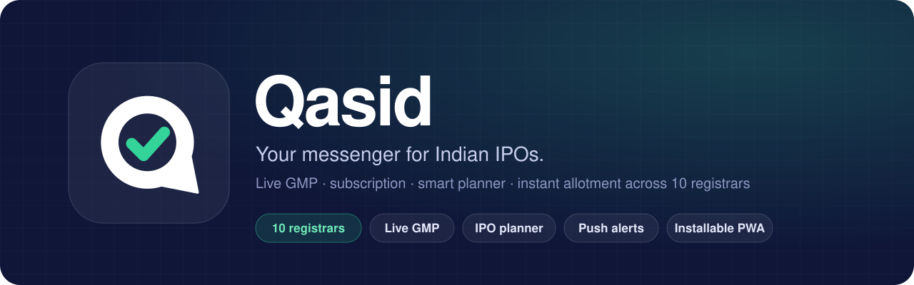
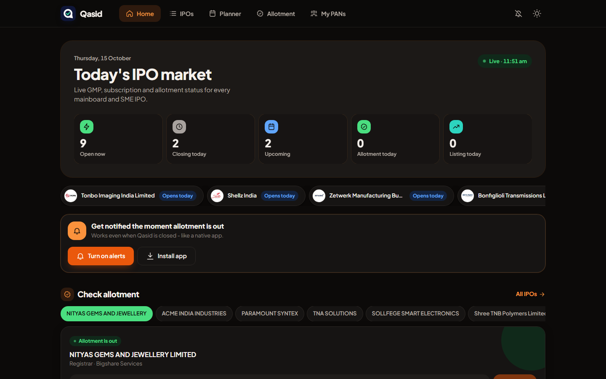
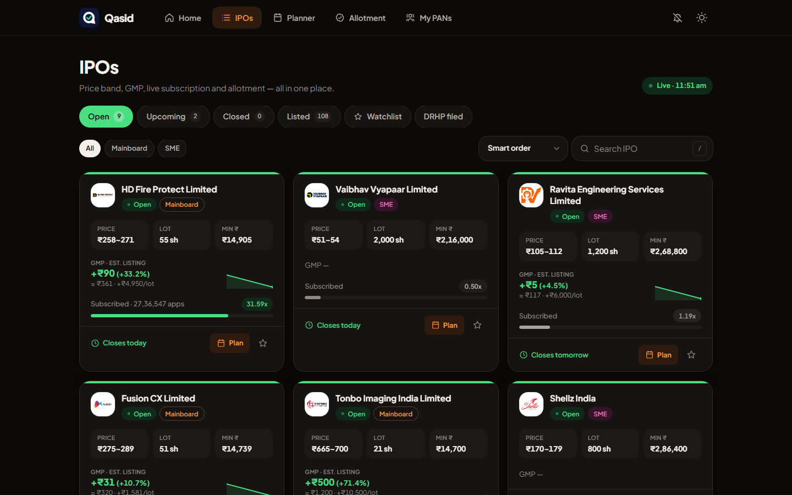
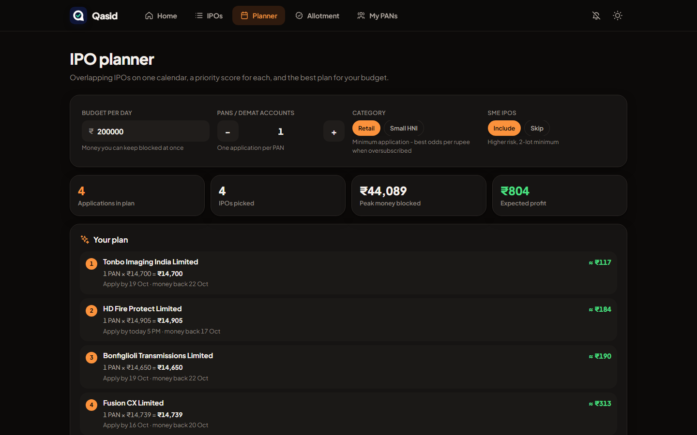
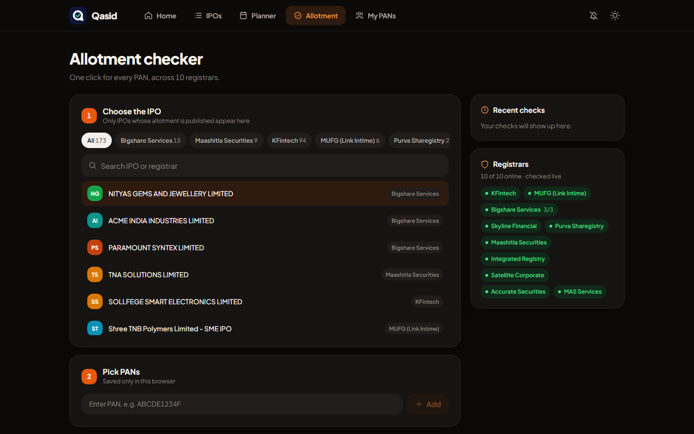
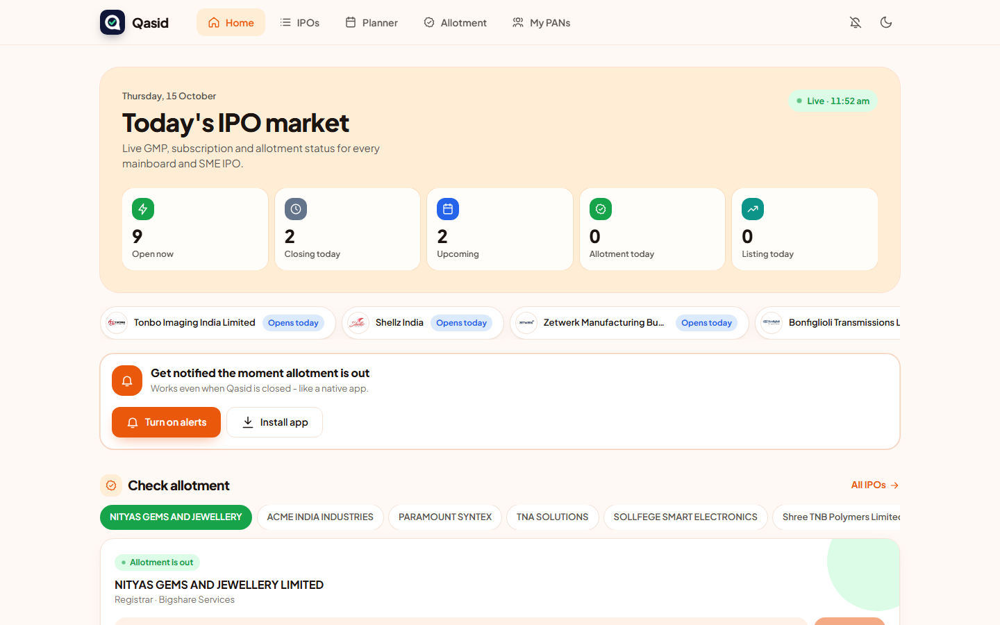
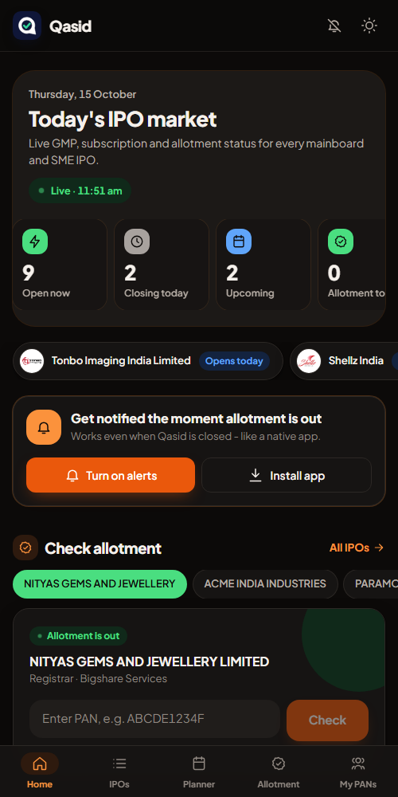
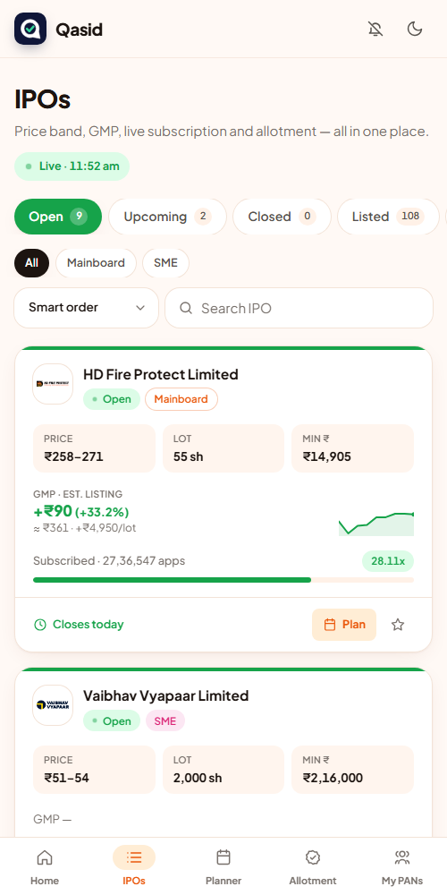
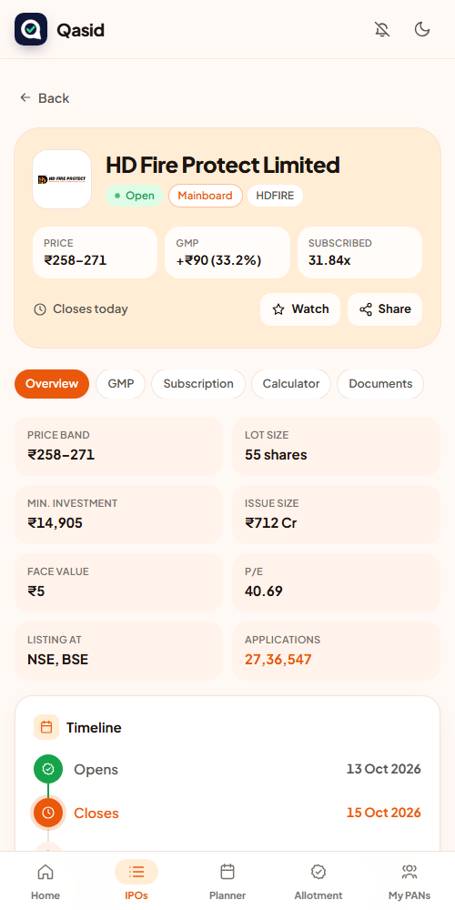

<div align="center">



<br />

**Live GMP, subscription, a smart IPO planner and instant allotment results across 10 registrars, all on one screen.**

<a href="https://qasid.thevellora.co.in"></a>
&nbsp;


</div>

---

> *Qasid* (قاصد) means **messenger**. The logo is a **Q** shaped like a message bubble with a tick inside: the message every IPO applicant is waiting for, *"you got the allotment."*

<div align="center">
  
</div>

## ✨ What it does

<table>
<tr>
<td width="50%" valign="top">

### ✅ Allotment checker
- **10 registrars in one place:** KFintech, MUFG (Link Intime), Bigshare, Skyline, Purva, Maashitla, Integrated, Satellite, Accurate and MAS.
- **Bulk PAN checks:** up to 50 PANs at once, run in parallel.
- **Bigshare failover** across all three mirrors, with per-server cooldowns.
- Saved PANs with nicknames, kept **only in your browser**.
- Multiple applications per PAN are added together. Results come with confetti, CSV export and WhatsApp sharing.

</td>
<td width="50%" valign="top">

### 📈 IPO dashboard
- **Open / Upcoming / Closed / Listed / Watchlist / DRHP** tabs, with Mainboard and SME filters.
- **GMP** with estimated listing price and profit per lot, plus a **GMP trend chart**.
- **Live category-wise subscription** (QIB, NII, bNII, sNII, Retail) and day-wise history.
- Lot calculator, timeline, RHP and anchor documents.
- Shareable links such as `#/ipo/SYMBOL`.

</td>
</tr>
<tr>
<td width="50%" valign="top">

### 🗓️ IPO planner
- **Overlap calendar:** bidding windows, blocked money, allotment and listing dates, day by day.
- **Priority score (0–100)** with a verdict (*Strong apply → Avoid*) and the reasons behind it.
- **Budget optimiser:** picks the IPOs and how many applications fit your budget, and reuses money as it is unblocked.

</td>
<td width="50%" valign="top">

### 🔔 Alerts
- **Push notifications** on phone and desktop when a new allotment is out, even with the app closed.
- **Auto-check:** your saved PANs are checked on the device as soon as the result is published.
- ★ Watchlist alerts when an IPO opens, closes or lists.
- Install it to your home screen like a native app.

</td>
</tr>
</table>

## 📸 Screenshots

<table>
<tr>
<td width="50%"><p align="center"><sub><b>IPO dashboard</b>: GMP, subscription and countdowns</sub></p></td>
<td width="50%"><p align="center"><sub><b>IPO planner</b>: budget plan and expected profit</sub></p></td>
</tr>
<tr>
<td width="50%"><p align="center"><sub><b>Allotment checker</b>: 10 registrars, live status</sub></p></td>
<td width="50%"><p align="center"><sub><b>Light theme</b></sub></p></td>
</tr>
</table>

<div align="center">
  
  &nbsp;
  
  &nbsp;
  
  <p><sub>Built mobile-first, with bottom navigation, a planner calendar and an installable PWA</sub></p>
</div>

## 🔒 API access

The Qasid API is **private**. It serves only the Qasid website (including the installed app), and isn't open for public or third-party use. There are no API keys.

- Browser requests need a signed, `HttpOnly` session cookie that is issued when the site loads, **and** a request from Qasid's own origin. A spoofed `Origin` header from a script is rejected.
- All endpoints are rate limited per IP and per session. PAN checks have their own tighter budget, because each PAN is a live lookup on a registrar.

> 💬 **Want API access** for a project, a bot or research? Please [open an issue](https://github.com/shahnavazpathan/Qasid/issues/new?title=API%20access%20request) or reach out to [@shahnavazpathan](https://github.com/shahnavazpathan) and describe what you're building.

## 🧭 Data sources

| Data | Source | Backup |
|---|---|---|
| Allotment | Each registrar's public allotment page | — |
| IPO calendar, GMP, SME subscription, allotment and listing dates | Investorgain | Chittorgarh |
| Logos, application count, fresh issue / OFS split | Chittorgarh | — |
| Symbols, price band, lot, RHP, live mainboard subscription | NSE India | Chittorgarh / Investorgain |
| DRHP / RHP filings | SEBI | — |
| GMP trend, day-wise subscription | Recorded by Qasid from the sources above | — |

## 🛠️ Tech stack

| Layer | Stack |
|---|---|
| Backend | Node.js, Express 5, Axios, web-push, SQLite (`database.sqlite`) |
| Frontend | React 19, Vite 6, Tailwind CSS 4, a service worker for offline use and push |
| Hosting | Render, which serves the built `client/dist` |

```
server.js               Express app, caching, allotment monitor, routes
lib/auth.js             API gate: session cookie, origin checks, rate limits
lib/registrars/*.js     One module per registrar: listIpos() + checkPan()
lib/market.js           IPO calendar / subscription / GMP / SEBI filings
lib/history.js          Daily GMP and subscription snapshots for trends
lib/push.js, store.js   Web push notifications, subscriber store
client/src/modules/     home, market, planner, allotment, pans, alerts
client/public/          logo, icons, manifest, service worker
```

## 🚀 Running locally

```bash
git clone https://github.com/shahnavazpathan/Qasid.git
cd Qasid
npm install
npm run build        # installs and builds the React client into client/dist
npm start            # http://localhost:3000
```

For frontend work, run `npm run dev:client`. Vite starts on `:5173` and forwards `/api` to `:3000`. Local development on `localhost` works without any keys.

<details>
<summary><b>Environment variables</b> (production)</summary>

| Variable | Purpose |
|---|---|
| `MONGODB_URI`, `MONGODB_DB` | **Required in production.** Stores push subscribers, announced allotments and server keys so they survive redeploys |
| `SESSION_SECRET` | Optional. Signs session cookies; if unset, one is generated once and kept in MongoDB |
| `VAPID_PUBLIC_KEY`, `VAPID_PRIVATE_KEY`, `VAPID_SUBJECT` | Optional web push keys; generated once and kept in MongoDB if unset |
| `EXTRA_ORIGINS` | More allowed site origins, separated by commas |
| `NSE_DISABLED` | Set to `1` to skip NSE (it blocks most cloud servers); IPO details then come from BSE, then Chittorgarh |
| `TRUST_PROXY` | Proxy hops to trust for client IPs (default `1` for Render; `0` when exposed directly) |

</details>

<details>
<summary><b>Adding a registrar</b></summary>

Create `lib/registrars/<name>.js` that exports `{ id, tag, label, website, concurrency, listIpos, checkPan }`, then register it in `lib/registrars/index.js`.
`checkPan(ipo, pan)` returns `{ status: "found" | "not_applied" | "error", name, applied, allotted, applications }`.

</details>

---

<div align="center">
<sub>Data is fetched live from public registrar, exchange and SEBI pages and may change without notice. GMP is unofficial and only indicative. <b>Qasid is not investment advice.</b></sub>
</div>
