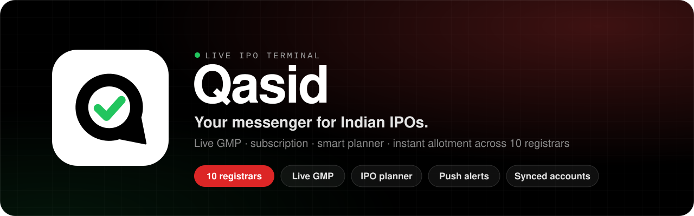
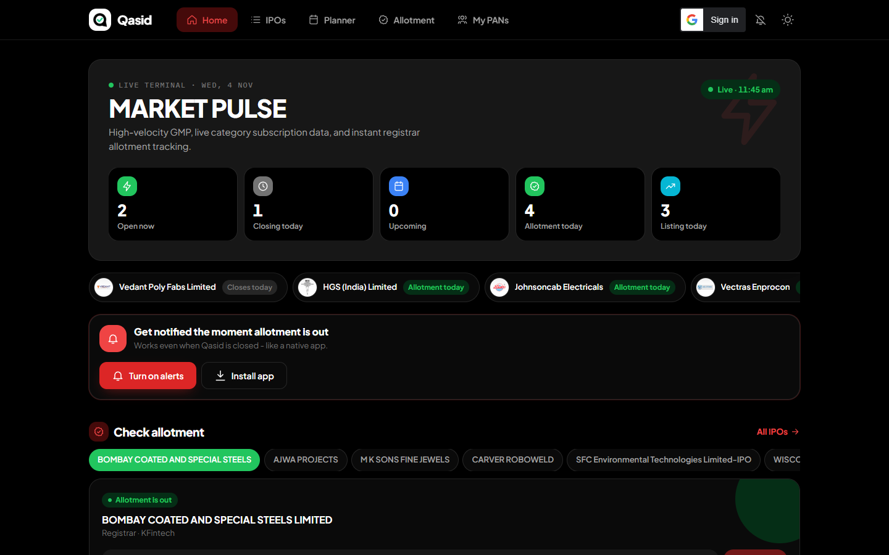
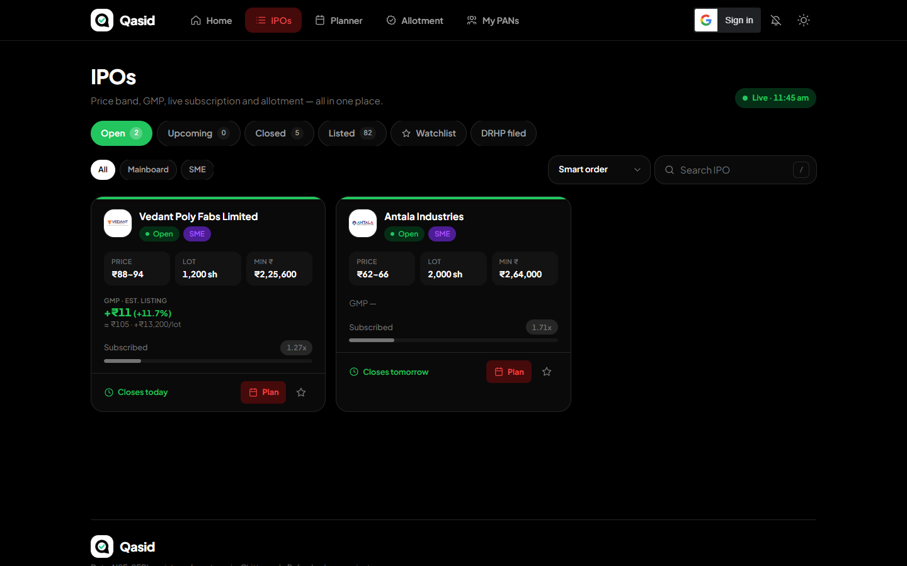
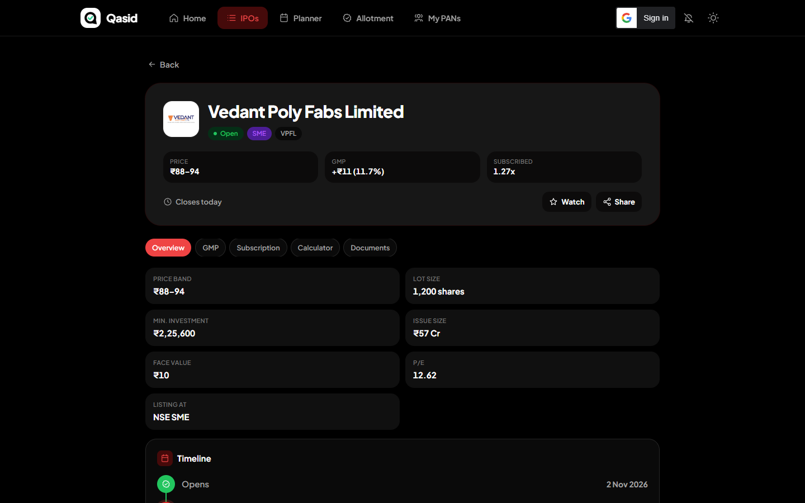
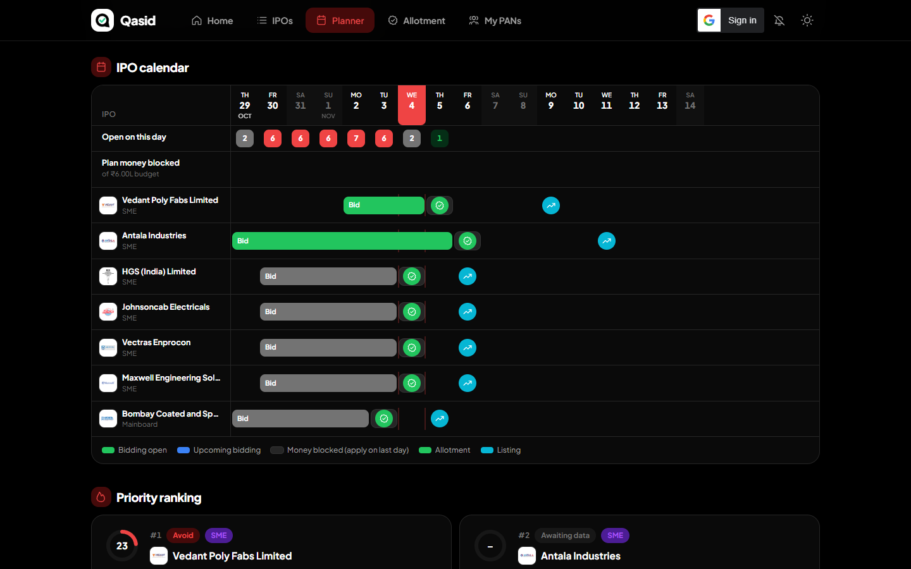
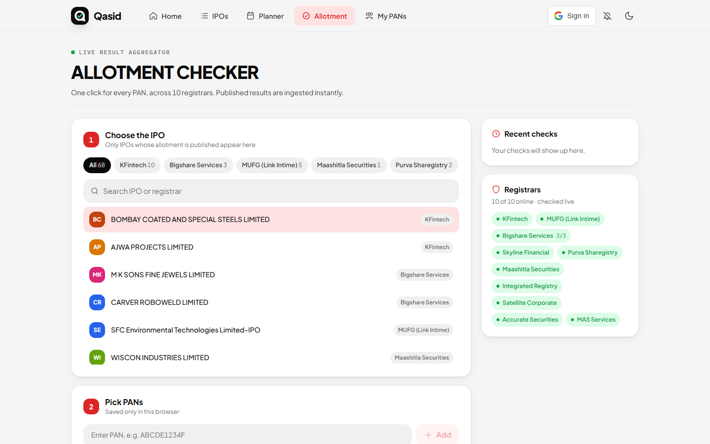
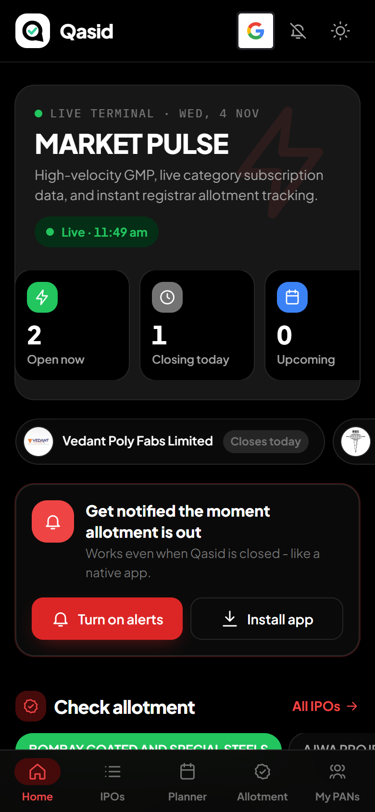
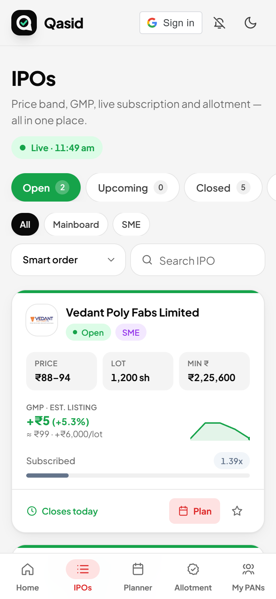
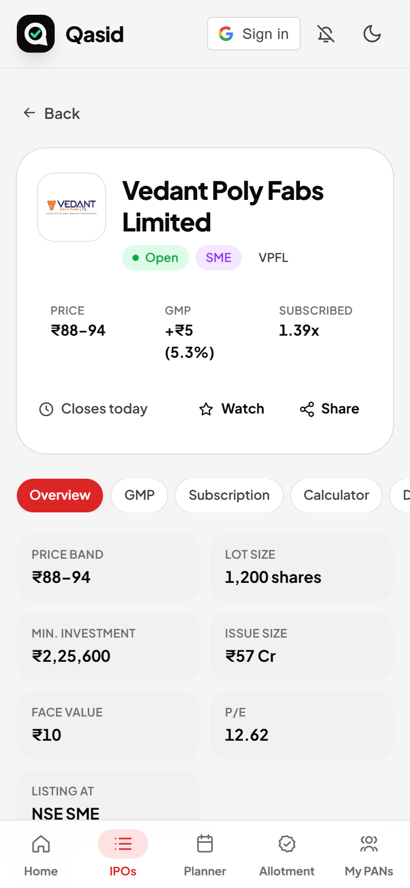
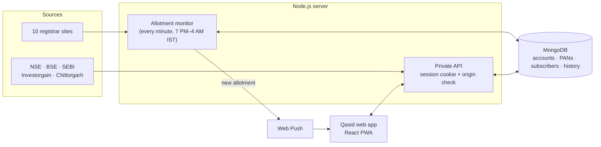

<div align="center">



<br />
<br />

**Live GMP, subscription, a smart IPO planner and instant allotment results across 10 registrars, on one screen.**

<a href="https://qasid.thevellora.co.in"></a>
&nbsp;


[Features](#features) · [Screenshots](#screenshots) · [How it works](#how-it-works) · [Running locally](#running-locally) · [Deployment](#deployment)

</div>

<br />

> *Qasid* (قاصد) means **messenger**. The logo is a **Q** shaped like a message bubble with a tick inside: the message every IPO applicant is waiting for, *"you got the allotment."*



## Features

<table>
<tr>
<td width="50%" valign="top">

#### Allotment checker
- **10 registrars in one place:** KFintech, MUFG (Link Intime), Bigshare, Skyline, Purva, Maashitla, Integrated, Satellite, Accurate and MAS.
- **Bulk checks:** up to 50 PANs at once, run in parallel.
- **Bigshare failover** across all three mirrors, with a cooldown per server.
- Multiple applications per PAN are added together. Results come with CSV export and WhatsApp sharing.

</td>
<td width="50%" valign="top">

#### IPO dashboard
- **Open, Upcoming, Closed, Listed, Watchlist and DRHP** tabs, with Mainboard and SME filters.
- **GMP** with estimated listing price and profit per lot, plus a **GMP trend chart**.
- **Live subscription by category** (QIB, NII, bNII, sNII, Retail) with day-wise history.
- Lot calculator, timeline, RHP and anchor documents, and shareable links such as `#/ipo/SYMBOL`.

</td>
</tr>
<tr>
<td width="50%" valign="top">

#### IPO planner
- **Overlap calendar:** bidding windows, blocked money, allotment and listing dates, day by day.
- **Priority score (0–100)** with a verdict (*Strong apply* to *Avoid*) and the reasons behind it.
- **Budget optimiser:** picks the IPOs and the number of applications that fit your budget, reusing money as it is unblocked.

</td>
<td width="50%" valign="top">

#### Accounts and alerts
- **Google sign-in:** saved PANs, nicknames and holder names follow you to every device. Without signing in, they stay in your browser.
- **Push notifications** on phone and desktop the moment an allotment is out, even with the app closed.
- **Auto-check** of your saved PANs as soon as a result is published, and ★ watchlist alerts when an IPO opens, closes or lists.
- **Installable** to the home screen, with a dark and a light theme.

</td>
</tr>
</table>

## Screenshots

<table>
<tr>
<td width="50%"><p align="center"><sub><b>IPO dashboard</b> · GMP, subscription and countdowns</sub></p></td>
<td width="50%"><p align="center"><sub><b>IPO detail</b> · price, GMP, subscription and timeline</sub></p></td>
</tr>
<tr>
<td width="50%"><p align="center"><sub><b>IPO planner</b> · every bidding window on one calendar</sub></p></td>
<td width="50%"><p align="center"><sub><b>Allotment checker</b> · 10 registrars, live status (light theme)</sub></p></td>
</tr>
</table>

<div align="center">
  
  &nbsp;&nbsp;
  
  &nbsp;&nbsp;
  
  <p><sub>Built for phones first: bottom navigation, installable, dark and light themes</sub></p>
</div>

## How it works



- **Allotment monitor.** The server checks every registrar's list once a minute in the evening (when results usually come out) and every five minutes the rest of the day. It records when each allotment was first seen, so only genuinely new results are announced, never old ones that reappear after a restart or a registrar outage.
- **Alerts.** A new allotment goes out as a Web Push notification to every subscribed device. If the server's push key ever changes, the app quietly registers again the next time it opens.
- **Accounts.** Google sign-in issues a signed, `HttpOnly` session cookie. Before anything is saved to the account, the user ticks a box agreeing to the [Terms](https://qasid.thevellora.co.in/terms.html) and [Privacy Policy](https://qasid.thevellora.co.in/privacy.html); the server logs the version, time, IP address and browser. PANs saved before signing in are then merged into the account. Signing out clears them from that device, and *Delete account* erases the account permanently.
- **Legal versions.** `LEGAL_VERSION` in `config/index.js` is the date of the current Terms and Privacy Policy. Change it whenever either page changes in substance, and every signed-in user is asked to agree again.

## Private API

The Qasid API serves only the Qasid website and installed app. It isn't open for public or third-party use, and there are no API keys.

- Browser requests need a signed session cookie that is issued when the site loads, **and** must come from Qasid's own address. A spoofed `Origin` header from a script is rejected.
- Every endpoint is rate limited per IP and per session. PAN checks have their own tighter budget, because each PAN is a live lookup on a registrar.

> **Want API access** for a project, a bot or research? [Open an issue](https://github.com/shahnavazpathan/Qasid/issues/new?title=API%20access%20request) or reach out to [@shahnavazpathan](https://github.com/shahnavazpathan) and describe what you're building.

## Data sources

| Data | Source | Fallback |
|---|---|---|
| Allotment results | Each registrar's public allotment page | — |
| IPO calendar, GMP, SME subscription, allotment and listing dates | Investorgain | Chittorgarh |
| Logos, application count, fresh issue / OFS split | Chittorgarh | — |
| Symbols, price band, lot, RHP, live mainboard subscription | NSE India | BSE, then Chittorgarh / Investorgain |
| DRHP / RHP filings | SEBI | — |
| GMP trend, day-wise subscription | Recorded by Qasid from the sources above | — |

## Tech stack

| Layer | Stack |
|---|---|
| Backend | Node.js 24, Express 5, Axios, web-push, google-auth-library |
| Storage | MongoDB Atlas: accounts, saved PANs, the Terms/Privacy agreement log, push subscribers, keys, GMP history, encrypted result archive |
| Frontend | React 19, Vite 6, Tailwind CSS 4, a service worker for offline use and push |
| Hosting | Render, serving the built app from `client/dist` |

```
server.js                 Startup: storage, keys, then the app and the allotment monitor
app.js                    Express app: redirect to the main address, API gate, routes
config/, middleware/      Settings (including LEGAL_VERSION); CORS, API gate and rate limits
routes/, controllers/     API routes: account (sign-in, PANs, agreement, delete), market, allotment, push
services/                 Registrar list refresh and the allotment monitor
lib/registrars/*.js       One module per registrar: listIpos() + checkPan()
lib/market.js             IPO calendar, subscription, GMP, SEBI filings
lib/allotments.js         First-seen registry that decides what is a new allotment
lib/auth.js               Session cookie, origin checks, rate limits
lib/store.js              MongoDB store (local JSON file in development)
lib/push.js, history.js   Web push; daily GMP and subscription snapshots
client/src/modules/       home, market, planner, allotment, pans, alerts
client/public/            Logo, icons, manifest, service worker, policy pages
```

## Running locally

Requires **Node.js 20 or newer**.

```bash
git clone https://github.com/shahnavazpathan/Qasid.git
cd Qasid
npm install
npm start            # http://localhost:3000
```

The server serves the built app in `client/dist`. Locally it needs no keys: without `MONGODB_URI` it keeps its data in `data/store.json`, and Google sign-in is simply unavailable.

To work on the frontend, run the server as above and, in a second terminal:

```bash
cd client
npm install
npm run dev          # http://localhost:5173, forwards /api to :3000
```

To rebuild `client/dist` with Google sign-in enabled, pass the OAuth client ID at build time:

```bash
cd client
VITE_GOOGLE_CLIENT_ID=<your-client-id>.apps.googleusercontent.com npx vite build
```

## Deployment

Qasid runs on Render as a Node web service: build command `npm install`, start command `node server.js`. The built frontend is committed in `client/dist`, so Render doesn't build it.

| Variable | Purpose |
|---|---|
| `MONGODB_URI` | **Required in production.** Keeps accounts, saved PANs, push subscribers and keys across deploys. Without it, everything is lost on each restart. |
| `MONGODB_DB` | Database name (default `qasid`) |
| `SESSION_SECRET` | **Recommended.** Signs session cookies; if unset, one is generated once and kept in MongoDB |
| `GOOGLE_CLIENT_ID` | OAuth client ID that Google sign-in tokens are checked against |
| `VAPID_PUBLIC_KEY`, `VAPID_PRIVATE_KEY`, `VAPID_SUBJECT` | Optional web push keys; generated once and kept in MongoDB if unset |
| `EXTRA_ORIGINS` | More allowed site addresses, separated by commas |
| `NSE_DISABLED` | Set to `1` to skip NSE, which blocks most cloud servers; details then come from BSE, then Chittorgarh |
| `TRUST_PROXY` | Proxy hops to trust for client IPs (default `1` for Render; `0` when exposed directly) |

The site lives at **qasid.thevellora.co.in**. Visits to the other addresses (`ipo.thevellora.co.in`, the `onrender.com` one) are redirected there, because Google sign-in only accepts that address.

<details>
<summary><b>Adding a registrar</b></summary>

<br />

Create `lib/registrars/<name>.js` exporting `{ id, tag, label, website, concurrency, listIpos, checkPan }`, then register it in `lib/registrars/index.js`.
`checkPan(ipo, pan)` returns `{ status: "found" | "not_applied" | "error", name, applied, allotted, applications }`.

</details>

---

<div align="center">
<sub>Data is fetched live from public registrar, exchange and SEBI pages and may change without notice. GMP is unofficial and only indicative. <b>Qasid is not investment advice.</b></sub>
<br />
<sub><a href="https://qasid.thevellora.co.in/privacy.html">Privacy policy</a> · <a href="https://qasid.thevellora.co.in/terms.html">Terms of service</a></sub>
</div>
